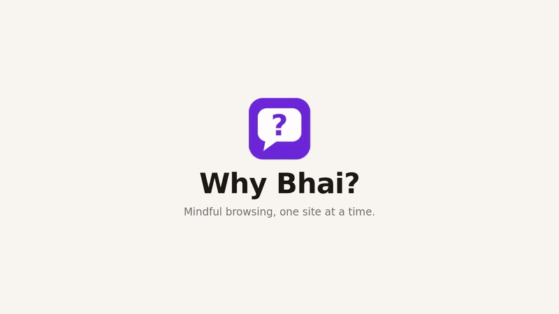
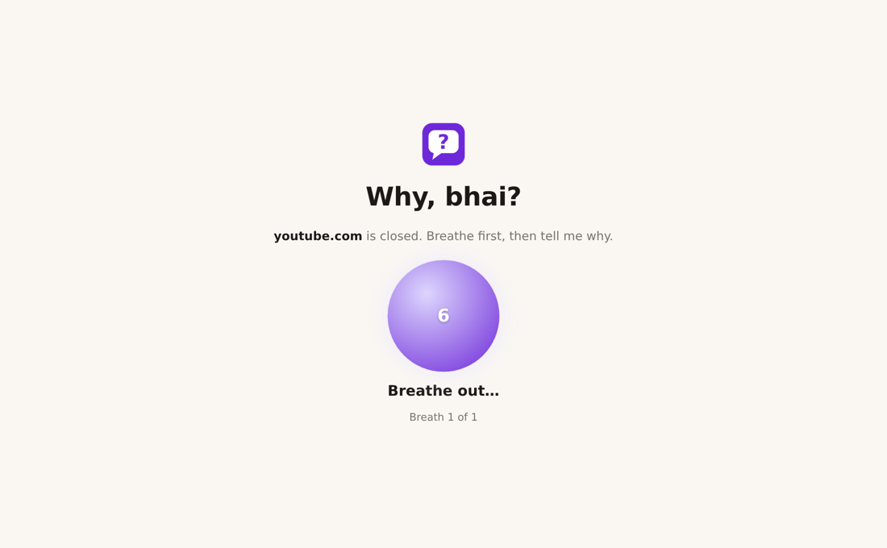
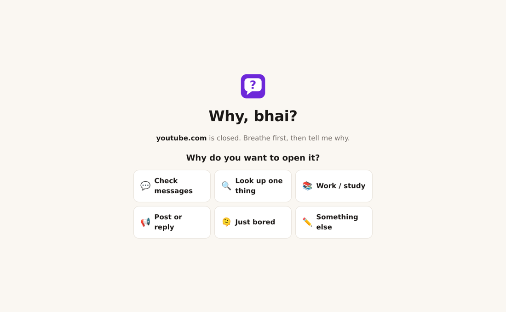
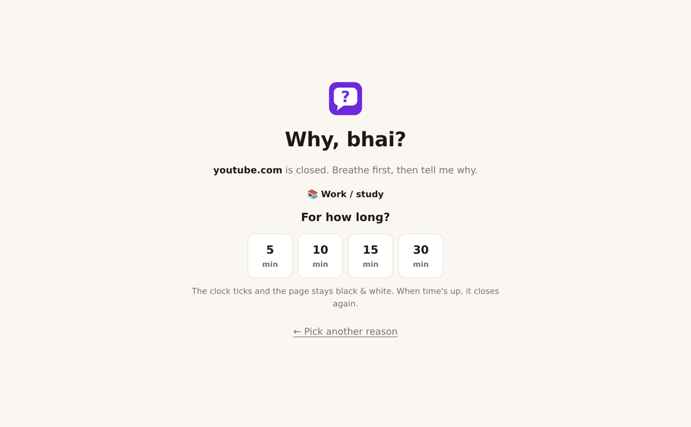
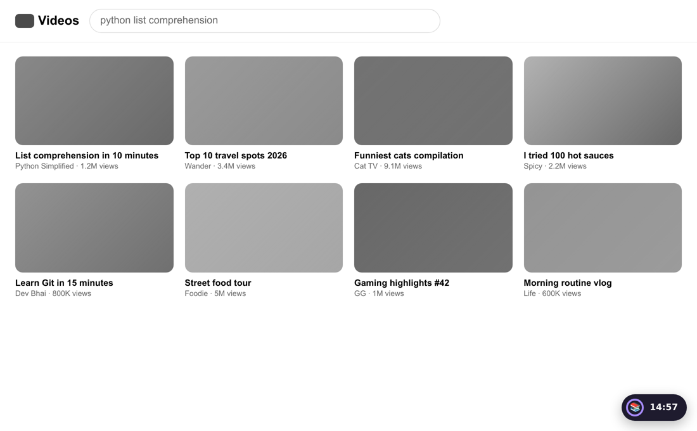
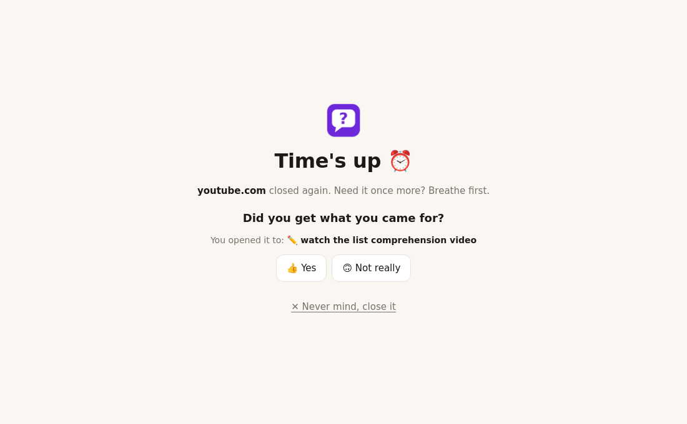
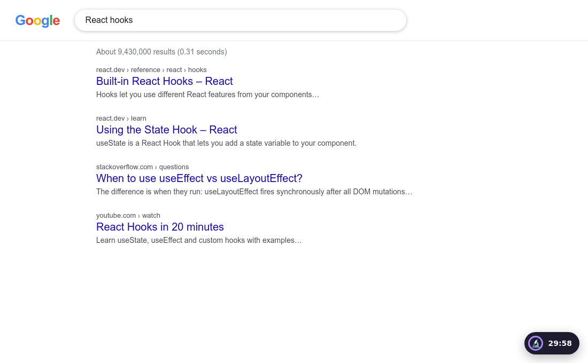
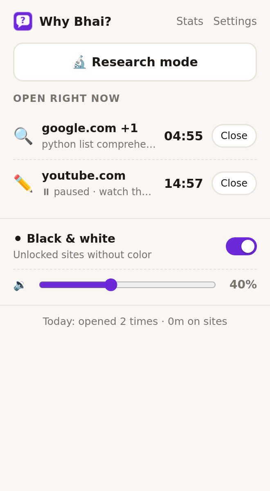
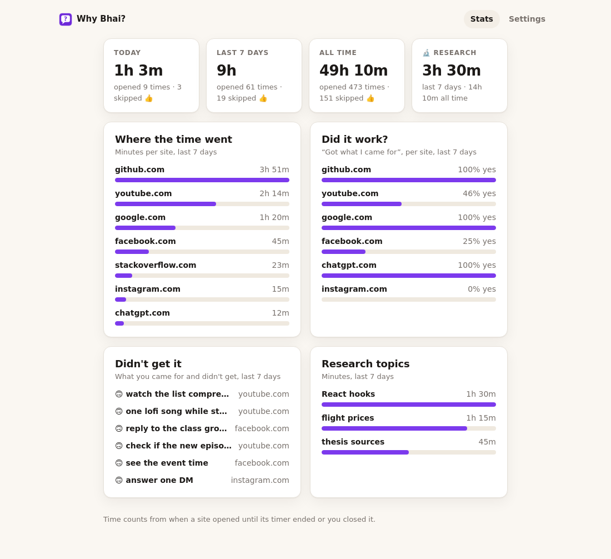
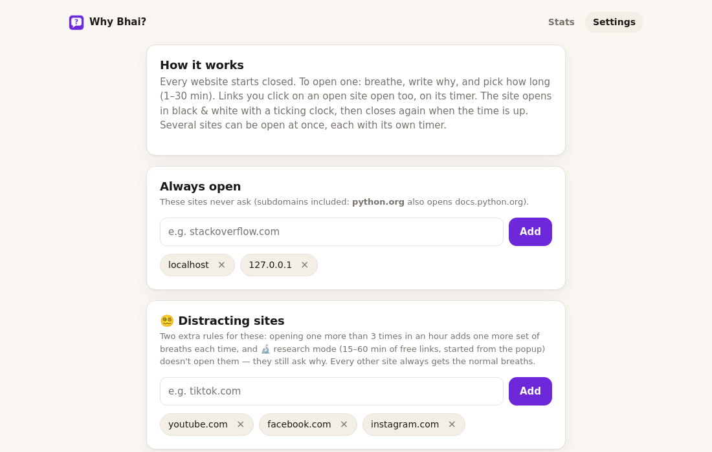

# Why Bhai? 🤔

Mindful browsing, one site at a time. Every website starts closed. To open one, you **breathe**, say **why**,
and pick **how long**. The site opens in black & white with a ticking clock, then closes again when time is up.

🎬 [Watch the demo video with voiceover (MP4, 1 min)](docs/why-bhai-demo.mp4)

The third of the Bhai family, next to [Hold On Bhai](https://github.com/AtiQ-Rahman/Hold-On-Bhai) (gentle speed bump)
and [Lock On Bhai](https://github.com/AtiQ-Rahman/Lock-On-Bhai) (strict focus lock).

## How it works
1. **Everything is closed.** Any site you open (Google too) lands on the *Why, bhai?* page. Tabs that were already open close when you install it.
2. **Breathe.** One set of slow breaths (3 by default): in for 4s, out for 6s.
3. **Why?** 💬 Check messages · 🔍 Look up one thing · 📚 Work / study · 📢 Post or reply · 🫠 Just bored · ✏️ Something else (write it).
4. **How long?** Only the times that fit the reason: 🔍 2–5 min, 💬 2–10, 📢 5–15, 📚 5–30. 🫠 *Just bored* costs one more set of breaths.
5. **The site opens** (with all its subdomains) in black & white, with a tick-tock clock and a floating timer that shows your reason.
   Press **✓ Done — close it** any time to close it and go back to the new tab page. When the time is up: a beep, and the site closes again.

Several sites can be open at once, each with its own timer. A site's timer runs only while it's on screen:
switch to another tab or minimize the window and it pauses, come back and it picks up where it left off.
Left paused for 30 minutes, the site closes again.

- **Did it work?** When a site's time runs out, it asks *"Did you get what you came for?"* — your answers show up in stats per reason.
- **Again and again?** Opening a *distracting site* (YouTube, Facebook, Instagram by default) more than 3 times in an hour adds one more set of breaths each time. Work sites like GitHub always get the normal breaths.

## 🔬 Research mode
For when you need to follow links everywhere: from the popup, breathe once, write the topic, and pick 15, 30, 45 or 60 minutes.
Every link opens freely (no black & white, no ticking) — except the *distracting sites* (YouTube, Facebook, Instagram), which still ask why. Edit that list in settings.
When the time is up, everything closes again. Press **✓ Done researching** to end it early (back to the new tab page).

## Also
- **Popup:** sites open right now with their timers (close any of them), a **black & white** toggle and a **volume** slider (0 = off).
- **Stats:** today, last 7 days and all time; minutes per site; which reasons you pick; how often they worked; research time and topics.
- **Settings:** always-open sites (`localhost` and `127.0.0.1` by default), breaths per visit, floating timer, sound, and **back to default settings**.

## Install (Brave, Chrome, Edge)
1. Open `chrome://extensions` and turn on **Developer mode**.
2. Click **Load unpacked** and pick the `extension/` folder.
3. Optional: **Details → Allow in Incognito**, otherwise Incognito windows stay open.

Shortcut: `Alt+Shift+W` opens the popup.

## Screenshots
| Breathe | Why? | How long? |
|---|---|---|
|  |  |  |

| Open in black & white | Did it work? | Research mode |
|---|---|---|
|  |  |  |

| Popup | Stats | Settings |
|---|---|---|
|  |  |  |

## Limits
Chrome doesn't let extensions block `chrome://` pages, so disabling the extension in `chrome://extensions` turns it off.
Only page loads are gated: an unlocked site can still show embeds (like a YouTube video) from other sites.
